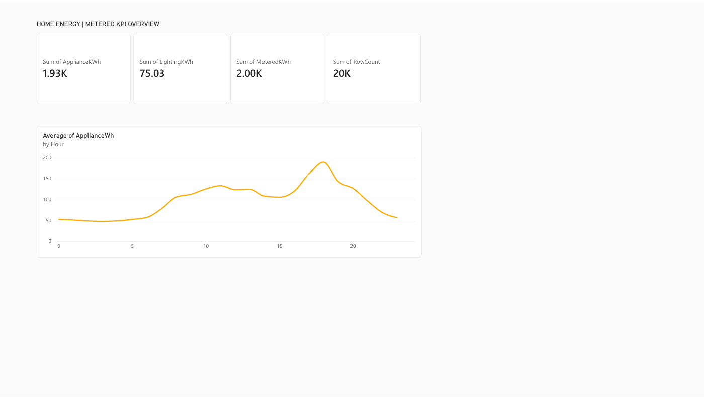
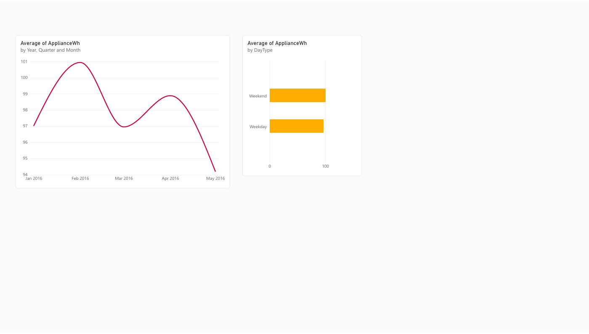
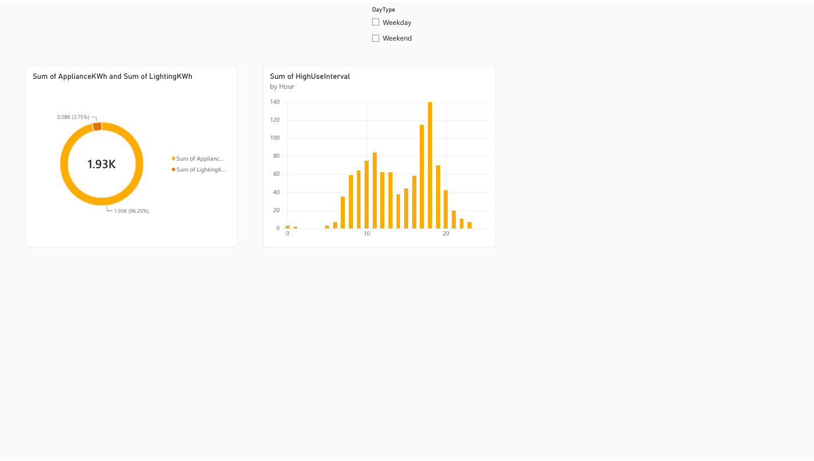

# Home Energy | Power BI Operations Dashboard

A reproducible energy-operations case study built from the [UCI Appliances Energy Prediction dataset](https://archive.ics.uci.edu/dataset/374/appliances%2Benergy%2Bprediction). The source contains ten-minute appliance, lighting, indoor-condition, and weather observations for one low-energy home. This project focuses on clear KPI units, full-day comparability, hourly demand shape, and interpretation limits.

## Power BI report

The [three-page interactive report](https://app.powerbi.com/groups/e6426da3-9b36-4519-acf1-2434daa552ae/reports/61e082bd-cb44-48d7-96ad-63d10ebc18cc) covers:

1. **Energy Overview:** four metered KPI cards and the mean ten-minute appliance load by hour.
2. **Calendar & Day Type:** mean appliance Wh per ten-minute interval by month, with Year → Quarter → Month → Day drill, alongside weekday/weekend means.
3. **Energy Mix & Peaks:** appliance-versus-lighting donut, high-use interval counts by hour, and a working Day Type slicer that filters both charts.

A separate [Home Energy KPI Dashboard](https://app.powerbi.com/groups/me/dashboards/86fd84c8-871f-44c1-a9b8-7ca7b63609eb) contains a pinned KPI tile linked to the source report. The report and dashboard live in Power BI My workspace and may require the owner's access. The [PDF export](visuals/home-energy-report.pdf) and public previews below allow anyone to review the visual results.





## Questions

- How much appliance and lighting energy was measured during the observation window?
- At which hours is appliance use highest, and how do weekdays compare with weekends?
- How does daily appliance energy vary across complete observation days?

## Reconciled results

| KPI | Result |
|---|---:|
| Ten-minute records | 19,735 |
| Complete days | 136 |
| Appliance energy, all intervals | 1,928.01 kWh |
| Lighting energy, all intervals | 75.03 kWh |
| Metered appliances + lighting | 2,003.04 kWh |
| Mean appliance reading | 97.70 Wh per ten minutes |

The mean ten-minute appliance reading is highest at 18:00 on complete days (190.17 Wh) and lowest at 03:00 (48.16 Wh). Complete-day appliance use averages 14.48 kWh/day on weekends and 13.85 kWh/day on weekdays. This is an observed pattern for one home, with no adjustment for weather or occupancy. See [Findings and limits](reports/FINDINGS.md).

## Reproduce

```bash
python -m pip install -r requirements.txt
python scripts/analyze.py
```

The script downloads the official UCI archive, validates 19,735 rows and uniform ten-minute spacing, and builds [the Power BI import table](data/events.csv) plus independent reconciliations under [reports](reports/). Source archive SHA-256: `2fccf354445d886e7917620b0195db1f3e3e34d5a067a93b844694a4c561255a`.

Power BI CSV source: `https://raw.githubusercontent.com/patelkautilya/home-energy-powerbi/main/data/events.csv`. See the [field guide](reports/FIELD_GUIDE.md) for metric definitions and units.

## Source and license

Candanedo, L. (2017). *Appliances Energy Prediction* [Dataset]. UCI Machine Learning Repository. [DOI 10.24432/C5VC8G](https://doi.org/10.24432/C5VC8G). Dataset licensed [CC BY 4.0](https://creativecommons.org/licenses/by/4.0/). This analysis credits the original source and does not present the single-home observations as representative of all buildings.

